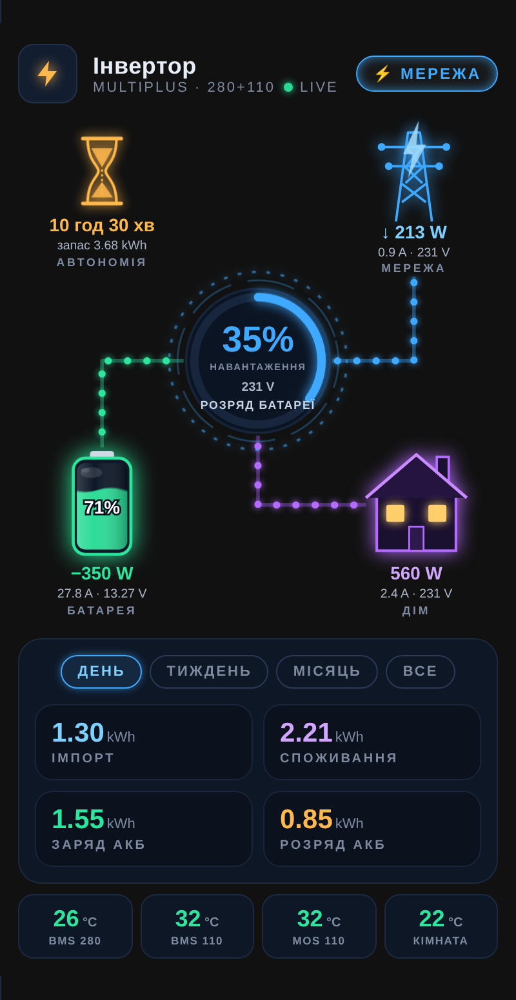
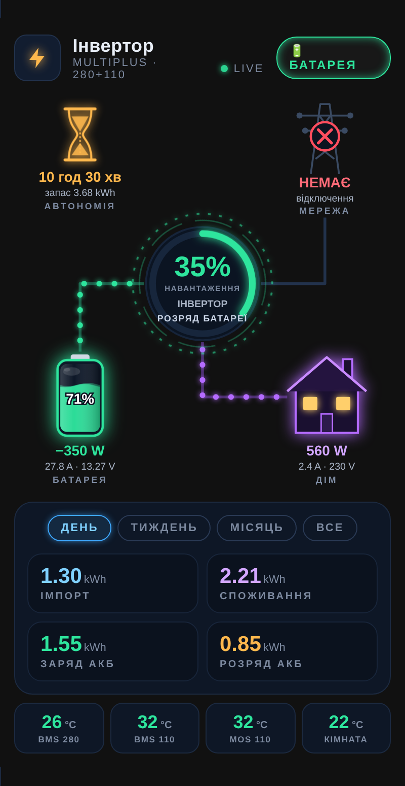

# Energy Neon Card

Neon-style animated power-flow card for Home Assistant: **grid → inverter → battery bank → home**, made for an off-grid / backup setup (Victron MultiPlus + parallel JK BMS batteries), but works with any sensors.

Неонова анімована картка потоків енергії для Home Assistant: мережа, інвертор, банк акумуляторів, дім. Інтерфейс картки українською.

<p align="center">
  
  
</p>

## Features

- Animated flow dots on grid / battery / home lines — direction follows the power sign, speed follows the power.
- Grid pylon glows when grid is present; turns grey with a red cross during an outage (grid voltage `unavailable` or < 100 V). Header badge and top stripe switch between **МЕРЕЖА** (blue) and **БАТАРЕЯ** (green).
- Battery with animated liquid level and waves; colour by SoC (green / amber < 30 % / red < 15 %), wave speed follows the current.
- Under the pylon: grid power, `A · V · Hz` and `cos φ · PF %` (optional `grid.frequency` / `grid.power_factor`).
- Centre ring: inverter load in % of `max_power`, grid voltage (and frequency, if given), inverter status text.
- Hourglass: remaining runtime while discharging, time to full while charging.
- Energy tiles for **day / week / month / all time** (import, home consumption, battery charge / discharge), read from HA long-term statistics — no reset needed.
- Row of temperature tiles.
- Several batteries: `voltage` is averaged, `remaining` and `capacity` are summed.

## Installation

### HACS (custom repository)
1. HACS → ⋮ → **Custom repositories** → `https://github.com/Rsa76d/energy-neon-card`, type **Dashboard**.
2. Install **Energy Neon Card**, then reload the browser (Ctrl+Shift+R).

### Manual
Copy `energy-neon-card.js` to `/config/www/` and add a resource: `/local/energy-neon-card.js`, type **JavaScript module**.

## Configuration

```yaml
type: custom:energy-neon-card
title: Інвертор
subtitle: MultiPlus · 280+110
max_power: 1600            # W, 100 % of the load ring
idle_power: 15             # W, below this a line counts as idle (default 15)
grid:
  power: sensor.grid_power         # W, + import
  voltage: sensor.grid_voltage     # V, unavailable/<100 V = outage
  current: sensor.grid_current     # A (optional)
  frequency: sensor.grid_frequency # Hz (optional), shown under the pylon: A · V · Hz
  power_factor: sensor.grid_pf     # cos φ 0…1 or % (optional), shown as "cos φ 0.96 · PF 96%"
frequency: sensor.grid_frequency   # Hz (optional)
battery:
  power: sensor.bank_power         # W, + charge / − discharge
  soc: sensor.bank_soc             # %
  current: sensor.bank_current     # A (optional)
  voltage:                         # one entity or a list (averaged)
    - sensor.bms_280_voltage
    - sensor.bms_110_voltage
  remaining:                       # Ah, list is summed (optional)
    - sensor.bms_280_remaining_capacity
    - sensor.bms_110_remaining_capacity
  capacity:                        # Ah, list is summed (optional)
    - sensor.bms_280_design_capacity
    - sensor.bms_110_design_capacity
home:
  power: sensor.home_power         # W
status: sensor.inverter_mode_status   # text, part before ":" is shown (optional)
capacity_kwh: 5                    # used only if remaining/capacity are not given
energy:                            # kWh sensors with state_class total / total_increasing
  import: sensor.grid_energy
  home: sensor.home_energy
  charge: sensor.bank_charge_energy
  discharge: sensor.bank_discharge_energy
temps:
  - entity: sensor.bms_280_temperature
    name: BMS 280
  - entity: sensor.bms_110_temperature
    name: BMS 110
    warn: 40                       # °C, amber (default 40)
    crit: 55                       # °C, red (default 55)
```

Only `battery` and `home` are required; every block you leave out is simply hidden or shows “—”.

## Credits

Visual idea inspired by the inverter card preview shown by **Stas (nafanjka)**, author of [BMS-HA-card](https://github.com/nafanjka/BMS-HA-card). This card is an independent implementation.

## License

MIT
